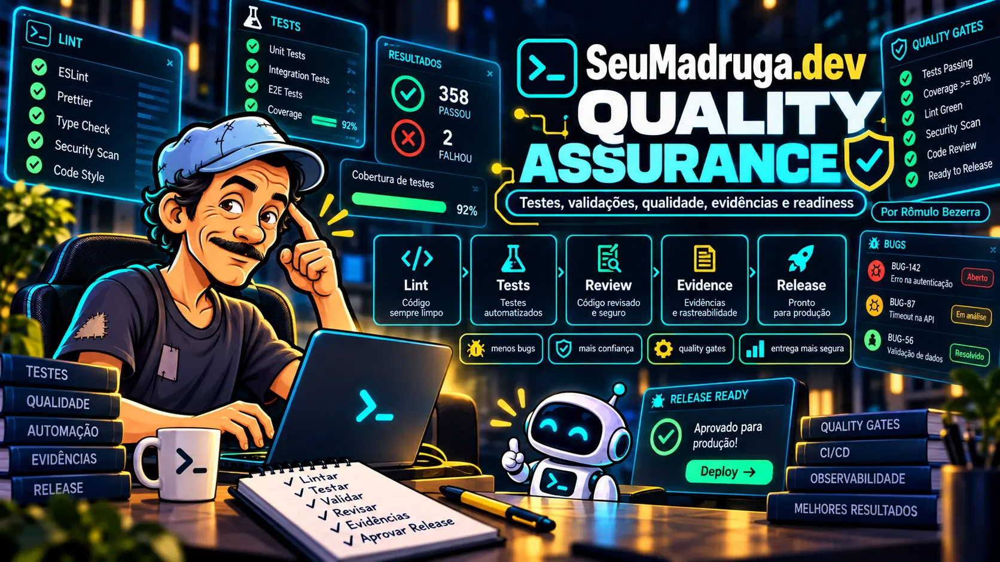

<p align="center">
  
</p>

<div align="center">

# SeuMadruga Ecosystem 2.0

### Nove especialidades. Um ecossistema. Projetos mais inteligentes.

**Orquestração de agentes · Engenharia · Design · Segurança · Dados · Conteúdo**

**Idealizado e criado por Rômulo Bezerra**

[](LICENSE)
[](core/skill-registry.json)
[](tools/skill_router.py)
[](https://github.com/quickplus2027/seu-madruga-dev/actions/workflows/validate.yml)

**[INSTALAR AGORA](#instale-o-ecossistema)** · **[CONHECER AS 9 SKILLS](#conheça-as-nove-skills)** · **[COMEÇAR A USAR](#primeiro-uso)** · **[DOCUMENTAÇÃO](#documentação-e-evolução)**

</div>

---

## O que é o SeuMadruga?

Imagine ter um conjunto de especialistas para apoiar cada etapa de um projeto, mas sem carregar todas as instruções desnecessariamente. Esse é o conceito do **SeuMadruga Ecosystem 2.0**: uma coleção aberta de Agent Skills para orientar fluxos de trabalho com Claude Code e OpenAI Codex.

O **CORE** organiza objetivo, risco, contexto e seleção de especialidades. As outras oito skills aprofundam temas como frontend, segurança, arquitetura, testes, vídeo, operações de IA, análise de dados e conteúdo.

<table>
<tr>
<td align="center"><strong>01 CORE</strong><br><sub>Coordenação e contexto</sub></td>
<td align="center"><strong>08 ESPECIALISTAS</strong><br><sub>Conhecimento sob demanda</sub></td>
<td align="center"><strong>100% EXPLÍCITO</strong><br><sub>Testes, limites e aprovações</sub></td>
</tr>
</table>

> **O que este projeto entrega:** arquivos `SKILL.md`, checklists, roteamento indicativo e utilitários offline. As instruções orientam o agente; não são um novo modelo de IA, uma garantia de economia de tokens ou um sistema que executa tarefas sozinho.

## Instale o ecossistema

### 🚀 Opção A — Instalação guiada das nove skills 2.0

**Recomendada para quem quer o ecossistema completo sem incluir a skill legada na seleção.** Copie e cole no terminal do seu projeto:

```bash
npx skills add quickplus2027/seu-madruga-dev --skill seu-madruga-core --skill design-system --skill cybersecurity --skill motion-studio --skill architecture --skill quality-assurance --skill ai-operations --skill data-experience --skill content-studio
```

O instalador poderá solicitar qual agente usar e o local da instalação. Escolha **Claude Code** ou **Codex** conforme o que utiliza e revise as opções antes de confirmar.

### 🎯 Opção B — Escolha apenas uma skill

Comece pelo CORE e adicione somente o que precisar:

```bash
npx skills add quickplus2027/seu-madruga-dev --skill seu-madruga-core
```

Para descobrir todas as skills que o instalador encontra no repositório:

```bash
npx skills add quickplus2027/seu-madruga-dev --list
```

<details>
<summary><strong>Ver os comandos individuais das nove skills</strong></summary>

| Skill | Instalação |
| :-- | :-- |
| SEUMADRUGA CORE | `npx skills add quickplus2027/seu-madruga-dev --skill seu-madruga-core` |
| DESIGN SYSTEM | `npx skills add quickplus2027/seu-madruga-dev --skill design-system` |
| CYBERSECURITY | `npx skills add quickplus2027/seu-madruga-dev --skill cybersecurity` |
| MOTION STUDIO | `npx skills add quickplus2027/seu-madruga-dev --skill motion-studio` |
| ARCHITECTURE | `npx skills add quickplus2027/seu-madruga-dev --skill architecture` |
| QUALITY ASSURANCE | `npx skills add quickplus2027/seu-madruga-dev --skill quality-assurance` |
| AI OPERATIONS | `npx skills add quickplus2027/seu-madruga-dev --skill ai-operations` |
| DATA EXPERIENCE | `npx skills add quickplus2027/seu-madruga-dev --skill data-experience` |
| CONTENT STUDIO | `npx skills add quickplus2027/seu-madruga-dev --skill content-studio` |

</details>

<details>
<summary><strong>⚙️ Instalação para todos os agentes e todas as skills do repositório</strong></summary>

O instalador também oferece:

```bash
npx skills add quickplus2027/seu-madruga-dev --all
```

**Atenção:** `--all` inclui **todas as skills disponíveis no repositório**, inclusive a skill original `seu-madruga-dev`, e pode instalar para **todos os agentes detectados**, sem solicitar confirmações. Use apenas quando desejar exatamente esse comportamento. A opção A é a escolha mais controlada para as nove skills do Ecosystem 2.0.

</details>

### 🧭 Tutorial em quatro passos para quem está começando

| Etapa | O que fazer | Onde |
| :-- | :-- | :-- |
| **1. Preparar** | Instale e configure seu Claude Code ou Codex; confirme que tem Node.js e npm. | [Node.js](https://nodejs.org/) · [Claude Code](https://code.claude.com/docs) · [Codex](https://developers.openai.com/codex/) |
| **2. Abrir** | Abra seu projeto e inicie um terminal. | VS Code: **Terminal → Novo Terminal**; Windows: **PowerShell** |
| **3. Instalar** | Cole o comando da opção A ou B acima. Leia e confirme as opções apresentadas. | Terminal |
| **4. Usar** | Abra uma nova sessão do agente, peça a skill pelo nome e confira a resposta. | Claude Code ou Codex |

<details>
<summary><strong>Não sei se o Node.js está instalado. Como verificar?</strong></summary>

No terminal, execute:

```bash
node --version
npm --version
```

Se os comandos não forem reconhecidos, instale o Node.js LTS e reabra o terminal. O `npx` é executado no **terminal**, não na caixa de conversa com o agente e nem na barra de endereço do navegador.

</details>

<details>
<summary><strong>A instalação terminou, mas a skill não aparece. O que fazer?</strong></summary>

1. Confira se selecionou o agente correto durante a instalação.
2. Inicie uma nova sessão dentro do projeto.
3. Peça para o agente localizar o arquivo `SKILL.md` da skill instalada e explicar quando ela deve ser utilizada.
4. Revise o [guia de ativação](docs/ACTIVATION.md) e a [compatibilidade](docs/COMPATIBILITY.md).

Instalar arquivos, o agente descobrir esses arquivos e o agente realmente seguir as instruções são três situações distintas.

</details>

<details>
<summary><strong>Posso instalar manualmente ou para todo o computador?</strong></summary>

Sim. Você pode copiar a pasta completa de cada skill, incluindo `SKILL.md` e `references/`, para o local suportado por sua versão do agente. O instalador também oferece opção de instalação global (`-g`), mas o caminho de descoberta depende do cliente. Consulte [as instruções detalhadas](docs/ECOSYSTEM_V2.md).

</details>

<sub>O instalador `npx skills` é uma ferramenta externa: revise sua procedência, permissões e eventuais perguntas de instalação. Referência: [documentação do Skills CLI](https://www.skills.sh/docs/cli).</sub>

---

## Primeiro uso

Depois de instalar, abra Claude Code ou Codex no projeto e experimente este pedido:

> Use `seu-madruga-core` para entender meu objetivo. Escolha as skills necessárias, verifique as instruções do projeto e proponha um plano. Antes de modificar arquivos, explique os riscos e peça aprovação quando apropriado. Ao terminar, diga o que foi testado e o que não foi.

**Quer uma interface marcante?** Peça `design-system` + `data-experience`. **Quer corrigir autenticação?** Peça `cybersecurity` + `quality-assurance`. **Vai criar um vídeo?** Use `motion-studio` + `content-studio`.

## Conheça as nove skills

As artes abaixo fazem parte da identidade oficial do projeto. A imagem **SeuMadruga CORE** aparece como **Capa Master** no topo desta página; cada uma das oito especialidades seguintes apresenta sua própria arte antes das explicações.

### 01 / SEUMADRUGA CORE

**O centro de decisão**

Organiza tarefas, define riscos, seleciona o contexto mínimo e propõe as especialidades certas.

| Para quem é | O que explorar |
| :-- | :-- |
| triagem de tarefas · orquestração · planejamento | [Ler a skill](skills/seu-madruga-core/SKILL.md) · [Abrir checklist](skills/seu-madruga-core/references/CHECKLIST.md) |

<details>
<summary><strong>Ver exemplo de uso e instalação individual</strong></summary>

**Experimente pedir ao agente:**

> Use a skill `seu-madruga-core`. Analise este projeto, selecione as skills úteis e apresente um plano antes de alterar arquivos.

**Instalar somente esta skill:**

```bash
npx skills add quickplus2027/seu-madruga-dev --skill seu-madruga-core
```

</details>

---

<p align="center">
  
</p>

### 02 / DESIGN SYSTEM

**Interfaces que comunicam**

Orienta sistemas visuais consistentes, hierarquia, componentes responsivos, acessibilidade e microinterações.

| Para quem é | O que explorar |
| :-- | :-- |
| UX/UI · frontend · design tokens | [Ler a skill](skills/design-system/SKILL.md) · [Abrir checklist](skills/design-system/references/CHECKLIST.md) |

<details>
<summary><strong>Ver exemplo de uso e instalação individual</strong></summary>

**Experimente pedir ao agente:**

> Use a skill `design-system`. Avalie o dashboard para celular e proponha melhorias de acessibilidade e design.

**Instalar somente esta skill:**

```bash
npx skills add quickplus2027/seu-madruga-dev --skill design-system
```

</details>

---

<p align="center">
  
</p>

### 03 / CYBERSECURITY

**Proteção desde a arquitetura**

Orienta revisão de autenticação, autorização, dados pessoais, superfícies de ataque e testes negativos.

| Para quem é | O que explorar |
| :-- | :-- |
| segurança · LGPD · APIs | [Ler a skill](skills/cybersecurity/SKILL.md) · [Abrir checklist](skills/cybersecurity/references/CHECKLIST.md) |

<details>
<summary><strong>Ver exemplo de uso e instalação individual</strong></summary>

**Experimente pedir ao agente:**

> Use a skill `cybersecurity`. Revise autenticação e permissões e indique riscos verificados e não testados.

**Instalar somente esta skill:**

```bash
npx skills add quickplus2027/seu-madruga-dev --skill cybersecurity
```

</details>

---

<p align="center">
  
</p>

### 04 / MOTION STUDIO

**Narrativas em movimento**

Orienta storyboard, cenas, sincronização e renderização de vídeos e animações programáticas.

| Para quem é | O que explorar |
| :-- | :-- |
| Remotion · reels · storyboard | [Ler a skill](skills/motion-studio/SKILL.md) · [Abrir checklist](skills/motion-studio/references/CHECKLIST.md) |

<details>
<summary><strong>Ver exemplo de uso e instalação individual</strong></summary>

**Experimente pedir ao agente:**

> Use a skill `motion-studio`. Planeje um vídeo de 20 segundos com cenas, transições e roteiro.

**Instalar somente esta skill:**

```bash
npx skills add quickplus2027/seu-madruga-dev --skill motion-studio
```

</details>

---

<p align="center">
  
</p>

### 05 / ARCHITECTURE

**Decisões técnicas fundamentadas**

Ajuda a estruturar requisitos, modelagem de dados, interfaces, decisões arquiteturais e migrações.

| Para quem é | O que explorar |
| :-- | :-- |
| PRD/TRD · APIs · ADRs | [Ler a skill](skills/architecture/SKILL.md) · [Abrir checklist](skills/architecture/references/CHECKLIST.md) |

<details>
<summary><strong>Ver exemplo de uso e instalação individual</strong></summary>

**Experimente pedir ao agente:**

> Use a skill `architecture`. Revise a arquitetura do meu SaaS e apresente alternativas com critérios de aceite.

**Instalar somente esta skill:**

```bash
npx skills add quickplus2027/seu-madruga-dev --skill architecture
```

</details>

---

<p align="center">
  
</p>

### 06 / QUALITY ASSURANCE

**Confiança sustentada por evidências**

Seleciona testes proporcionais ao risco, revisa regressões e diferencia resultados confirmados de verificações pendentes.

| Para quem é | O que explorar |
| :-- | :-- |
| testes · CI · regressão | [Ler a skill](skills/quality-assurance/SKILL.md) · [Abrir checklist](skills/quality-assurance/references/CHECKLIST.md) |

<details>
<summary><strong>Ver exemplo de uso e instalação individual</strong></summary>

**Experimente pedir ao agente:**

> Use a skill `quality-assurance`. Revise as alterações, execute testes disponíveis e relate PASS, FAIL e NOT_RUN.

**Instalar somente esta skill:**

```bash
npx skills add quickplus2027/seu-madruga-dev --skill quality-assurance
```

</details>

---

<p align="center">
  
</p>

### 07 / AI OPERATIONS

**IA com eficiência e controle**

Ajuda a selecionar ferramentas e modelos disponíveis, reduzir contexto redundante e organizar handoffs.

| Para quem é | O que explorar |
| :-- | :-- |
| MCP · agentes · tokens | [Ler a skill](skills/ai-operations/SKILL.md) · [Abrir checklist](skills/ai-operations/references/CHECKLIST.md) |

<details>
<summary><strong>Ver exemplo de uso e instalação individual</strong></summary>

**Experimente pedir ao agente:**

> Use a skill `ai-operations`. Avalie como reduzir trabalho repetido sem comprometer a qualidade das respostas.

**Instalar somente esta skill:**

```bash
npx skills add quickplus2027/seu-madruga-dev --skill ai-operations
```

</details>

---

<p align="center">
  
</p>

### 08 / DATA EXPERIENCE

**Dados que orientam decisões**

Define boas práticas para KPIs, painéis interativos, filtros, gráficos honestos e alternativas acessíveis.

| Para quem é | O que explorar |
| :-- | :-- |
| dashboards · métricas · gráficos | [Ler a skill](skills/data-experience/SKILL.md) · [Abrir checklist](skills/data-experience/references/CHECKLIST.md) |

<details>
<summary><strong>Ver exemplo de uso e instalação individual</strong></summary>

**Experimente pedir ao agente:**

> Use a skill `data-experience`. Transforme estes indicadores em um painel claro com filtros, tooltips e contexto.

**Instalar somente esta skill:**

```bash
npx skills add quickplus2027/seu-madruga-dev --skill data-experience
```

</details>

---

<p align="center">
  
</p>

### 09 / CONTENT STUDIO

**Conteúdo com clareza e propósito**

Orienta roteiros, carrosséis e conteúdo editorial com consistência de marca e revisão factual.

| Para quem é | O que explorar |
| :-- | :-- |
| conteúdo · carrosséis · reels | [Ler a skill](skills/content-studio/SKILL.md) · [Abrir checklist](skills/content-studio/references/CHECKLIST.md) |

<details>
<summary><strong>Ver exemplo de uso e instalação individual</strong></summary>

**Experimente pedir ao agente:**

> Use a skill `content-studio`. Crie uma proposta de carrossel com narrativa, CTA e layout legível no celular.

**Instalar somente esta skill:**

```bash
npx skills add quickplus2027/seu-madruga-dev --skill content-studio
```

</details>


## Como o trabalho é organizado

```text
       SUA SOLICITAÇÃO
              │
              ▼
        SEUMADRUGA CORE
    objetivo · escopo · risco
              │
              ▼
     ESCOLHA DAS ESPECIALIDADES
  somente o contexto necessário
              │
              ▼
  PLANO → EXECUÇÃO AUTORIZADA
              │
              ▼
   TESTES → EVIDÊNCIAS → ENTREGA
```

O repositório contém um roteador opcional, baseado em correspondência de palavras-chave:

```bash
python tools/skill_router.py "Criar dashboard responsivo com autenticação"
```

Ele **recomenda** especialidades, mas não instala skills, troca modelos ou ativa agentes por conta própria. O [registro central](core/skill-registry.json) descreve as especialidades e a [política de roteamento](core/ROUTING_POLICY.md) define o uso seletivo.

## Como combinar as skills

| Seu objetivo | Combinação sugerida | O que priorizar |
| :-- | :-- | :-- |
| Construir dashboard | CORE + Design System + Data Experience | clareza, filtros, responsividade |
| Melhorar segurança | CORE + Cybersecurity + Quality Assurance | permissões, riscos, testes |
| Planejar SaaS | CORE + Architecture + Cybersecurity | requisitos, dados, decisões |
| Criar vídeos | CORE + Motion Studio + Content Studio | cenas, texto, renderização |
| Otimizar o trabalho com IA | CORE + AI Operations | contexto, ferramentas, handoff |

## Tecnologias e estrutura

O projeto usa **Markdown/Agent Skills**, **Python com biblioteca padrão** para os utilitários offline e **GitHub Actions** para validações automatizadas.

```text
seu-madruga-dev/
├── branding/
│   ├── ecosystem-v2/        # Nove artes das skills
│   └── seu-madruga-dev-mark* # Identidade original
├── skills/
│   ├── seu-madruga-core/    # Orquestrador
│   ├── design-system/       # UI e UX
│   ├── cybersecurity/      # Segurança
│   ├── motion-studio/      # Animação e vídeo
│   ├── architecture/       # Arquitetura
│   ├── quality-assurance/  # Testes
│   ├── ai-operations/      # Operações de IA
│   ├── data-experience/    # Dados
│   ├── content-studio/     # Conteúdo
│   └── seu-madruga-dev/    # Skill original preservada
├── core/                   # Registro e contratos
├── docs/                   # Guias e referências
├── tools/                  # CLI e checks em Python
├── tests/                  # Testes unitários e estruturais
├── AGENTS.md               # Orientações para agentes
├── CLAUDE.md               # Orientações para Claude Code
└── README.md
```

## Qualidade que pode ser conferida

A versão atual possui verificações estruturais e testes offline. Para reproduzi-los em um clone local:

```bash
python tests/validate_skill.py
python -m unittest discover -s tests -p "test_*.py"
python -m py_compile tools/madruga.py tools/quality_gates.py tools/skill_router.py
```

O [workflow de validação](.github/workflows/validate.yml) executa o conjunto de verificações nele configurado. Isso não comprova auditoria integral de segurança, conformidade completa de acessibilidade ou economia mensurada de tokens.

Os relatórios devem distinguir **PASS, WARN, FAIL, NOT_RUN e NOT_APPLICABLE**, conforme o [contrato de qualidade](core/QUALITY_CONTRACT.md).

## Documentação e evolução

<table>
<tr>
<td width="50%" valign="top">

**Para começar**

- [Como usar](docs/COMO_USAR.md)
- [Ativação guiada](docs/ACTIVATION.md)
- [Ecosystem 2.0](docs/ECOSYSTEM_V2.md)
- [Instalação no Windows](docs/INSTALL_WINDOWS.md)
- [Compatibilidade](docs/COMPATIBILITY.md)

</td>
<td width="50%" valign="top">

**Para desenvolver e contribuir**

- [Quality Gates](docs/QUALITY_GATES.md)
- [Roadmap](docs/ROADMAP.md)
- [Avaliação e métricas](EVALUATION.md)
- [Segurança](SECURITY.md)
- [Contribuições](CONTRIBUTING.md)

</td>
</tr>
</table>

O [roadmap](docs/ROADMAP.md) registra propostas de avaliação, compatibilidade e melhorias de verificações. Marcos futuros não devem ser confundidos com recursos já implementados.

---

<div align="center">


### SeuMadruga.dev

**Token não dá em árvore.**

**Criado por Rômulo Bezerra** · [GitHub @quickplus2027](https://github.com/quickplus2027)

[Licença MIT](LICENSE) · [Código de contribuição](CONTRIBUTING.md) · [Segurança](SECURITY.md)

<sub>Projeto independente, sem afiliação oficial com OpenAI, Anthropic ou os titulares da série Chaves. A licença do código não concede automaticamente direitos sobre marcas ou personagens de terceiros.</sub>

</div>
